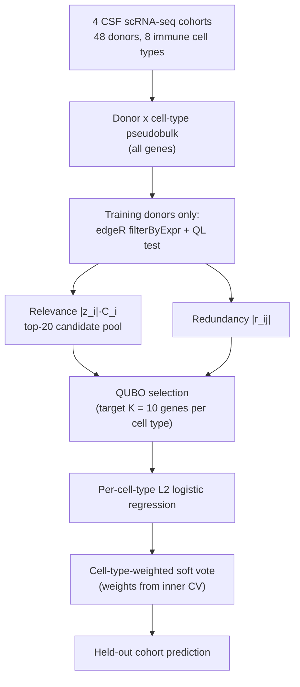

# quboFS

**quboFS** selects compact, low-redundancy gene panels per cell type from donor-level
single-cell RNA-seq (scRNA-seq) pseudobulk data. Gene relevance, pairwise redundancy and
panel size are optimised jointly as a Quadratic Unconstrained Binary Optimization (QUBO)
problem, solved by classical simulated annealing (no quantum hardware). Selection is
independent of the downstream classifier.

The method was developed and benchmarked for multiple sclerosis (MS) versus control
classification on four public cerebrospinal fluid (CSF) scRNA-seq cohorts, with
leave-one-cohort-out validation inside a leak-free nested cross-validation, and applied
to two blood (PBMC) cohorts.

This repository contains the installable package (`src/qubofs`, selection step) and the
complete manuscript analysis (`scripts/`). Version 0.2.0 corresponds to the revised
manuscript; the earlier analysis is archived as v0.1.4.

## Pipeline at a glance



Everything that uses diagnosis labels — the edgeR gene universe and statistics, gene
selection, the choice of λ and γ, the classifiers and the cell-type weights — is computed
within training folds. Held-out cohorts are used only for prediction.

## Method summary

For each cell type and training set, quboFS selects **x** ∈ {0,1}^20 over the 20 most
relevant candidate genes by minimising

```
H(x) = − Σ_i s_i x_i  +  γ Σ_{i≠j} |r_ij| x_i x_j  +  λ ( Σ_i x_i − K )²
```

- `s_i`: relevance `|z_i|·C_i` scaled to [0, 1], where `z_i` is the edgeR MS-versus-control
  statistic and `C_i` the fraction of training cohorts agreeing in direction;
- `r_ij`: Pearson correlation of the genes across training donors;
- `K = 10` (soft constraint; a panel can have fewer genes when the remaining candidates are
  redundant), `λ ∈ {2, 5}` and `γ ∈ {0.5, 1}` chosen by inner cross-validation.

Comparators (DE-top, mRMR, LASSO, elastic net) use the same candidate pool, panel size,
classifier and ensemble. Full specification: `docs/method_details.md`.

## Installation

```bash
git clone https://github.com/christina-18/qubofs.git
cd qubofs
python3 -m venv .venv && source .venv/bin/activate
pip install -e .                    # package: numpy + pandas only
pip install -r requirements.txt     # manuscript analysis: adds scipy, matplotlib
```

Python ≥ 3.10. The R preprocessing needs R ≥ 4.2 with Seurat (v5), Matrix, edgeR and dplyr.

## Quick start (package)

```bash
python examples/quickstart.py       # synthetic toy data, no R or patient data needed
```

```python
from qubofs import Pipeline
pipe = Pipeline(K=10, gamma=0.5, lambda_=2.0)          # solver="exact" for the exact minimum
pipe.fit(pseudobulk_per_celltype, donor_meta, relevance_per_celltype)
pipe.selected_panels_
```

`relevance_per_celltype` holds, per cell type, the absolute edgeR statistic of the genes
kept by `edgeR::filterByExpr` on the training donors. `qubofs.ensemble` provides the
cell-type weights and weighted soft vote; the CLI is `qubofs run` / `qubofs info`.

## Reproducing the manuscript

```bash
export QUBOFS_SEURAT_RDS_RAW=... QUBOFS_SEURAT_RDS=... QUBOFS_SEURAT_RDS_CLEAN=...
export QUBOFS_DATA_DIR=/path/to/data QUBOFS_RESULTS_DIR=/path/to/results
bash scripts/01_preprocessing/run_preprocessing.sh    # R: pseudobulk and edgeR per training set
bash scripts/02_benchmark/run_all.sh                  # nested CV, 5 methods, CSF and PBMC
bash scripts/03_evaluation/run_all.sh                 # statistics, sensitivity analyses, figures
```

The raw data are public but not redistributed (accessions in `docs/reproduction.md`). The
fixed outer folds are in `data_release/fold_assignments.csv`. All seeds are fixed.

## Main results (CSF, 3 held-out cohorts × 5 outer-fold models)

| Method | ROC-AUC | PR-AUC | Brier | Within-panel \|r\| (training) |
|---|---:|---:|---:|---:|
| quboFS | 0.883 | 0.922 | 0.234 | **0.226** |
| Elastic net | 0.869 | 0.908 | 0.236 | 0.343 |
| mRMR | 0.853 | 0.900 | 0.237 | 0.293 |
| LASSO | 0.829 | 0.883 | 0.242 | 0.329 |
| DE-top | 0.819 | 0.867 | 0.241 | 0.350 |

Mean over the three held-out cohorts (cell-type-weighted soft vote). quboFS had the lowest
within-panel redundancy against every comparator in all 8 cell types (cell-type-level
sign-flip test, Holm-adjusted p = 0.031), also when the comparators were restricted to the
quboFS panel size. Its ROC-AUC did not differ from elastic net or mRMR (95% donor-bootstrap
intervals of the differences include 0). In the PBMC nested CV, quboFS again had the lowest
redundancy (0.305 vs 0.376–0.470) with within-cohort ROC-AUC 0.854 (comparators
0.823–0.884). quboFS is a panel-design method: the contribution is lower redundancy at
comparable accuracy, not higher accuracy. Per-model results: `data_release/`.

## Repository layout

```
qubofs/
├── src/qubofs/          # package: relevance, QUBO (SA / exact), pipeline, ensemble, filters, metrics, CLI
├── scripts/
│   ├── 01_preprocessing/   # R: cleaning, pseudobulk, edgeR for every training set
│   ├── 02_benchmark/       # Python: nested CV, quboFS and 4 comparators, CSF and PBMC
│   └── 03_evaluation/      # Python: performance, redundancy, stability, sensitivity, figures
├── examples/            # quickstart.py + synthetic toy_data/
├── tests/               # pytest
├── data_release/        # fold assignments, selected genes, benchmark results
└── docs/                # method_details.md, reproduction.md
```

## Citation

Please cite the manuscript and the software (`CITATION.cff`). Software releases are
archived on Zenodo (all versions: https://doi.org/10.5281/zenodo.20851198; v0.1.4: https://doi.org/10.5281/zenodo.21133701). Maintained by the
corresponding author, M. Asada.

## Licence

MIT — see `LICENSE`.
